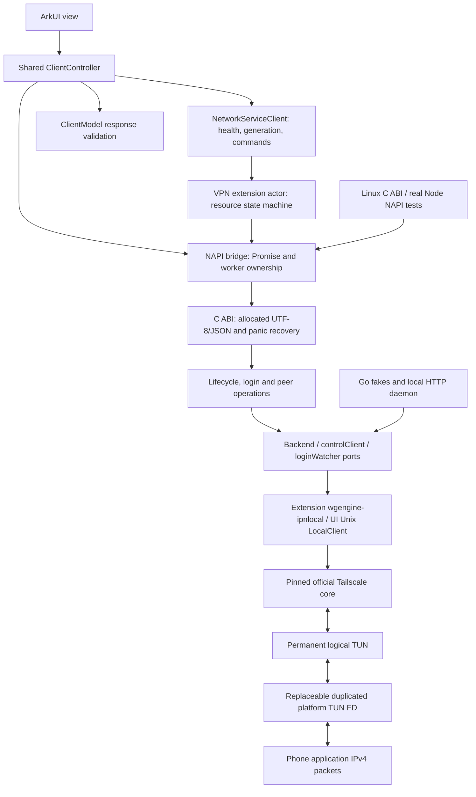

# Architecture and contracts

## Boundaries

| Location | Responsibility | Server verification |
| --- | --- | --- |
| `core/main.go` | Fixed C exports, allocated results, free, panic shield | Export tests + ctypes + loaded Node addon |
| `core/runtime.go` | Global single instance, locking, platform socket policy | race, Start/Close serialization, netns regression |
| `core/backend.go` | Narrow production adapters to pinned upstream | Real LocalClient + fake local HTTP/IPN stream |
| `core/service_backend.go`, `vpn.go` | State lease, authoritative VPN owner, Unix LocalAPI, independent VPN state | Real backend, socket IPC, overlap/retry/failure tests |
| `core/switch_tun.go`, `packet_tun.go` | Permanent device, detachable borrowed-FD duplicates, raw packet I/O and joined shutdown | OFF packet discard, repeated reattach and real official-engine encrypted packets |
| `core/login.go` | Subscribe, request, events, timeout, snapshot, cleanup | Events/errors/cancellation/order/cleanup Mock |
| `core/operations.go` | Start/close/status/logout/online queries | Injected backend + lifecycle and query failures |
| `core/status.go`, `types.go` | Wire fields, conversion, filters, JSON | Go tests + generated Go fixtures consumed by UI |
| `core/logging.go` | Bounded owned snapshots, NUL escaping, auth redaction | Concurrency, suffix retention, privacy regressions |
| `core/diagnostics.go` | Probe adapters and failure aggregation | Injectable probes + HTTP faults + real loopback |
| `entry/.../napi_init.cpp` | Parameters, workers, strings and Promise completion | Actual production source compiled as Node addon |
| `ClientModel.ets`, `ClientController.ets`, `Index.ets` | Wire validation, shared controller; page contains rendering/confirmation only | Actual production controller + mocked platform ports, target ArkTS compilation |
| `NetworkServiceModel.ets`, `NetworkServicePlatform.ets` | Extension resource actor, live authentication, SDK create/protect/destroy and core lifecycle | Actual production actor with delayed/failing ports, ownership and cleanup tests |
| `NetworkServiceClient.ets`, `NetworkServiceStore.ets` | Serialized intents, native health, owner/command generations, private atomic file IPC | Existing-service reuse, stale heartbeat, delayed SDK lease and cancellation tests |
| `SessionPreview.ets` | Atomic whitelisted display cache, never live authentication/VPN proof | Production codec/storage calls + delayed startup, expiry, logout and I/O failure |

One extension-owned core handles product login, discovery and VPN. Normal OFF
does not replace it: detach joins platform FD I/O, then destroys the vNIC while
retaining the official backend, control connection and state lease. ON attaches
a fresh protected vNIC to the same logical device. Page lifetime only controls
UI observers/foreground queries. It does not own the engine or accepted commands.

This is not a permanent singleton across process lifetimes. HarmonyOS can stop
the extension; generic AppServiceExtensionAbility is not a phone replacement.
The first service bootstrap may require system VPN-service authorization even
while the toggle is OFF. No vNIC/routes are installed until ON. See
[3.3.0 platform constraints and acceptance](vpn-3.3.0.md).

The existing C ABI 3 contracts are preserved with additive service exports. Factory
injection exists only inside Go; no mock or test-only ABI is packaged in the app.
Tests modifying the singleton/factory run serially; concurrency tests use the
production locks and the Go race detector.

Saved metadata can paint the dashboard before native initialization completes.
Official status alone determines authentication and readiness, and the owner's
independent VPN state determines connection. Historical peers are labelled stale.
See [3.2.4](vpn-3.2.4.md) for the earlier display-cache change.

The UI verifies private service snapshots against live native engine identity
and health. A stale heartbeat alone does not authorize killing a healthy core.
Owner-bound commands are checked after awaited SDK calls; late ON completion
must respect cancellation. Unresolved SDK operations retain their request lease
until actual settlement. Cleanup is confirmed only after native detach, original
FD close and SDK destroy, not just a native disconnected report.

Atomic app-private snapshots/commands currently use bounded polling; this is
not a public TCP API, event-only RPC or a system keepalive mechanism. Diagnostics
include core ID/start time, boot duration, service phase, stop reason, interface
resource flags and cumulative packet/byte counters. Abrupt process killing
cannot run onDestroy reliably: an old snapshot indicates uncertainty, not a
proven system stop reason such as high traffic.

## Networking

OpenHarmony selects upstream Linux netns code. Both modes disable its socket
controls so route discovery failure cannot bind control sockets to `lo`. VPN
transport instead boots without any vNIC, then uses extension process protection
and own-bundle exclusion before attaching system packet traffic.
Diagnostics now use the netns dialer family and the actual `/key?v=123` endpoint,
not an unrelated default HTTP transport. A successful probe proves only that
request/transport, not subsequent Noise registration or VPN connectivity.

For service/UI ownership, packet lifetime and acceptance boundaries see
[VPN Alpha](vpn-alpha.md). System DNS, default routing and IPv6 are not enabled.

## UI testing boundary

The server harness executes the actual `ClientController.ets` and service actor/
client after transpiling with the pinned SDK TypeScript compiler. It does not
duplicate a JS controller. Native and UIAbilityContext are
injected module/object fakes; Node mock timers make polling deterministic.
Full builders and ArkTS restrictions are compiled separately by Hvigor. This
harness is not an ArkUI renderer and is not evidence for pixel layout.
