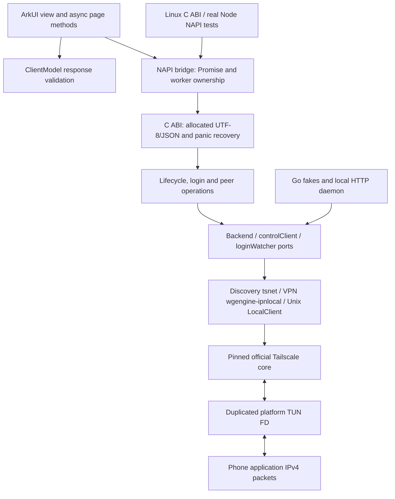

# Architecture and contracts

## Boundaries

| Location | Responsibility | Server verification |
| --- | --- | --- |
| `core/main.go` | Fixed C exports, allocated results, free, panic shield | Export tests + ctypes + loaded Node addon |
| `core/runtime.go` | Global single instance, locking, platform socket policy | race, Start/Close serialization, netns regression |
| `core/backend.go` | Narrow production adapters to pinned upstream | Real LocalClient + fake local HTTP/IPN stream |
| `core/service_backend.go`, `vpn.go` | State lease, authoritative VPN owner, Unix LocalAPI, independent VPN state | Real backend, socket IPC, overlap/retry/failure tests |
| `core/packet_tun.go` | Borrowed-FD duplication, raw packet I/O and joined shutdown | Socketpair, pending read cancellation, real official-engine encrypted packets |
| `core/login.go` | Subscribe, request, events, timeout, snapshot, cleanup | Events/errors/cancellation/order/cleanup Mock |
| `core/operations.go` | Start/close/status/logout/online queries | Injected backend + lifecycle and query failures |
| `core/status.go`, `types.go` | Wire fields, conversion, filters, JSON | Go tests + generated Go fixtures consumed by UI |
| `core/logging.go` | Bounded owned snapshots, NUL escaping, auth redaction | Concurrency, suffix retention, privacy regressions |
| `core/diagnostics.go` | Probe adapters and failure aggregation | Injectable probes + HTTP faults + real loopback |
| `entry/.../napi_init.cpp` | Parameters, workers, strings and Promise completion | Actual production source compiled as Node addon |
| `ClientModel.ets`, `Index.ets` | Wire validation, page state, browser and polling | Actual production methods + mocked platform ports |

A single core instance matches the app's lifecycle. This change deliberately
keeps the existing C ABI 3 contracts with additive VPN exports. Factory
injection exists only inside Go; no mock or test-only ABI is packaged in the app.
Tests modifying the singleton/factory run serially; concurrency tests use the
production locks and the Go race detector.

## Networking

OpenHarmony selects upstream Linux netns code. Both modes disable its socket
controls so route discovery failure cannot bind control sockets to `lo`. VPN
transport instead uses extension process protection before engine creation.
Diagnostics now use the netns dialer family and the actual `/key?v=123` endpoint,
not an unrelated default HTTP transport. A successful probe proves only that
request/transport, not subsequent Noise registration or VPN connectivity.

For service/UI ownership, packet lifetime and acceptance boundaries see
[VPN Alpha](vpn-alpha.md). System DNS, default routing and IPv6 are not enabled.

## UI testing boundary

The server harness executes methods from `Index.ets` after removing ArkUI-only
struct/decorator/builder syntax and transpiling with the pinned SDK TypeScript
compiler. It does not duplicate a JS controller. Native and UIAbilityContext are
injected module/object fakes; Node mock timers make polling deterministic.
Full builders and ArkTS restrictions are compiled separately by Hvigor. This
harness is not an ArkUI renderer and is not evidence for pixel layout.
